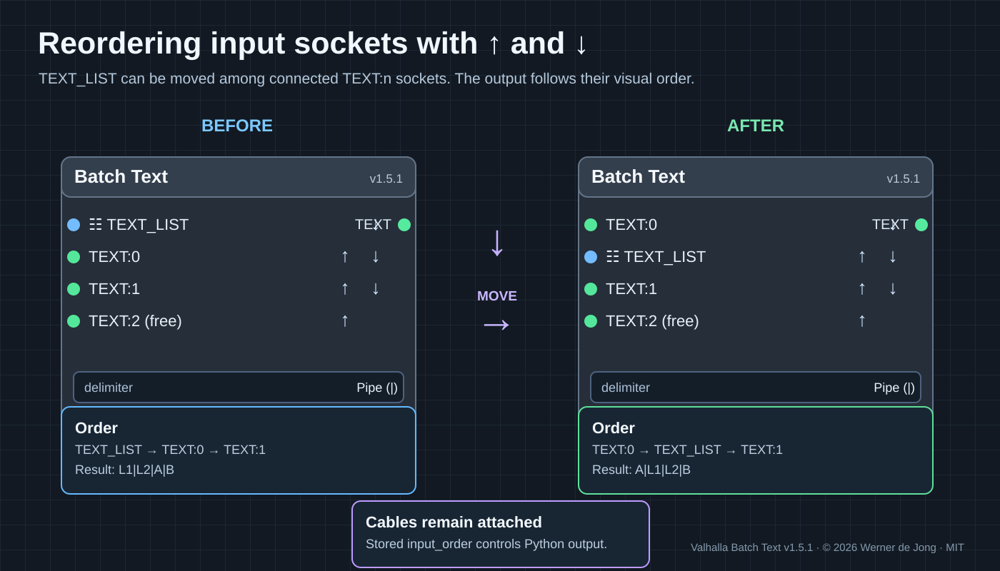

# Valhalla Batch Text v1.5.1 — English edition for ComfyUI

**Conceived and created by Werner de Jong.** © 2026 Werner de Jong.  
**Free to use — MIT License.** See [`LICENSE`](LICENSE) for the full terms.

## Overview

Batch Text joins an optional **native ComfyUI STRING list** and **any number of connected STRING inputs** into one `STRING` result. The join operation is performed in Python using `delimiter.join(parts)`.

This release introduces reorderable input sockets while retaining the English interface and older-workflow compatibility. **The node class remains `ValhallaBatchText`**, so existing connections and workflows can be retained. The dropdown labels, tooltips, Info popup, installer messages, and documentation are in English. Older Dutch dropdown values are translated on workflow load where possible.

### Connectors

- **☷ TEXT_LIST** — Optional square input for a *native ComfyUI STRING list*. A node producing multiple STRING values with `OUTPUT_IS_LIST=(True,)` can feed this input. In Python, Batch Text receives lists because `INPUT_IS_LIST=True`. It is not a universal socket for arbitrary custom list types, and **a single multiline string is still one item**.
- **TEXT:0, TEXT:1, ...** — Ordinary STRING inputs. Connecting the last free input reveals another free input automatically. There is no hardcoded input limit; practical ComfyUI/browser limits still apply.
- **TEXT** — A single combined STRING output.

**Join order:** the **current top-to-bottom order of the connected sockets**, including `TEXT_LIST` when present. Move any eligible input using the arrow controls beside the socket. A `TEXT_LIST` expands to its individual items at its position in this order. Unconnected inputs are ignored, but connected empty strings are included. Duplicate text is retained.

## New in v1.5.1 — reorder inputs with arrow controls

**The order shown on the node now determines the Python join order.** Use the small **up/down arrows drawn beside an input** to move it relative to the other inputs. This changes the **processing order**, not merely how the node looks.

- `TEXT_LIST` is also movable; it no longer has to contribute its items first.
- The existing cable **remains attached to the same source** when its socket moves. Numbered `TEXT:n` labels may be renumbered to reflect the new positions.
- The last unconnected `TEXT:n` placeholder is reserved for new connections, not a prompt element.
- The chosen order is saved in the workflow through a hidden `input_order` value and serialized for API execution. Do not edit this value manually.
- Workflows saved with older node versions have a compatible fallback: `TEXT_LIST` first, then numbered `TEXT:n` slots.
- The `delimiter` remains applied **between every item** of the joined sequence.

**Example:** `TEXT:0 = A`, `TEXT_LIST = [L1, L2]`, `TEXT:1 = B`, with delimiter `Pipe (|)`.

| Visual top-to-bottom order | Output |
| --- | --- |
| `TEXT_LIST`, `TEXT:0`, `TEXT:1` | `L1|L2|A|B` |
| `TEXT:0`, `TEXT_LIST`, `TEXT:1` | `A|L1|L2|B` |
| `TEXT:0`, `TEXT:1`, `TEXT_LIST` | `A|B|L1|L2` |



For more examples, see the [illustrated documentation](docs/README.md) or [reordering guide](docs/wiki/Reordering-Inputs.md).

## Delimiter dropdown

| Selection | Actual separator |
| --- | --- |
| `None (direct)` | Empty string (direct concatenation) |
| `Space ( )` | Single space |
| `Comma (, )` | Comma followed by a space |
| `Comma (,)` | Comma |
| `Semicolon (; )` | Semicolon followed by a space |
| `Semicolon (;)` | Semicolon |
| `Colon (: )` | Colon followed by a space |
| `Colon (:)` | Colon |
| `Pipe ( \| )` | Space + pipe + space |
| `Pipe (\|)` | Pipe |
| `Tab (\t)` | Tab control character |
| `LF (\n)` | Line feed (U+000A) |
| `CR (\r)` | Carriage return (U+000D) |
| `CRLF (\r\n)` | Windows-style line ending |
| `Blank line (\n\n)` | Two line-feed characters |
| `Custom` | Any text entered in `custom_delimiter` |

**Custom** reveals the `custom_delimiter` field. You can type any literal text, emoji, punctuation, spaces, or actual line breaks. The following typed escapes are also supported: `\n` for LF, `\r` for CR, `\t` for tab, and `\\` for a literal backslash. To insert the two literal characters `\n`, type `\\n`. Unknown escapes such as `\q` are left unchanged. An empty Custom separator joins directly.

**Example:** `TEXT:0 = "Mara"`, `TEXT:1 = "Greek dress"`, `delimiter = Comma (, )` produces `Mara, Greek dress`.

The **ⓘ Info** button opens an English help dialog, including examples, an explanation of the list port, and the author / MIT-license attribution.

## Installation / upgrade

Choose one method, with **ComfyUI fully stopped**:

**Git installation (recommended)** — in your active ComfyUI `custom_nodes` directory:

```bash
git clone https://github.com/darkvalley/ComfyUI-Valhalla-BatchText.git
```

Restart ComfyUI and hard-refresh the web interface (Ctrl+Shift+R).

**Manual installation** — download this repository as ZIP, extract it, and copy its content (including `__init__.py`, `batch_text.py` and `web/`) into one directory such as `ComfyUI/custom_nodes/ComfyUI-Valhalla-BatchText/`.

**Upgrading from the earlier standalone ZIP release:** Back up workflows and delete or rename the **old** `custom_nodes/Valhalla_BatchText` folder before using a Git clone at `custom_nodes/ComfyUI-Valhalla-BatchText`. Do not keep both directories active: they register the same `ValhallaBatchText` class and frontend extension.

Repository layout:

```text
ComfyUI-Valhalla-BatchText/
├── __init__.py
├── batch_text.py
├── LICENSE
├── README.md
├── CHANGELOG.md
├── web/js/batch_text.js
└── tests/
```

No external Python packages are required. This extension uses the same node class name as v1.0–v1.5.1.

## Compatibility with older workflows

- **Node class:** unchanged, `ValhallaBatchText`.
- **Text connectors:** unchanged (`TEXT:n`, `TEXT_LIST`, and `TEXT`).
- **Old Dutch dropdown labels:** the frontend recognizes Dutch values saved in v1.2/v1.3 workflows and changes them to the equivalent English selection when the workflow is loaded (for example, `Lege regel (\n\n)` → `Blank line (\n\n)`). Custom text is preserved.
- **Older literal delimiters:** the node also attempts to migrate the pre-dropdown v1.0/v1.1 format, including literal backslashes.
- **Python layer:** still recognizes Dutch preset labels and older raw separators for direct function calls. **However, ComfyUI may reject old API-format prompts with Dutch combo values at schema validation before calling Python.** For those API JSON files, use the English dropdown values, or load and re-save a UI workflow after checking its separator.

**Back up your workflow JSON before saving it with a new node version.** Frontend migration has been tested in a simulated LiteGraph environment, but not on your specific ComfyUI installation.

## Quick verification

1. Connect `ABC` to `TEXT:0`, `DEF` to `TEXT:1`, and the `TEXT` output to `Preview as Text`.
2. Select **None (direct)** → `ABCDEF`.
3. Select **Comma (, )** → `ABC, DEF`.
4. Select **LF (\n)** → two separate lines.
5. Select **CRLF (\r\n)** → the output contains the exact CR+LF sequence.
6. Select **Custom**, enter ` <> ` → `ABC <> DEF`.
7. Open **ⓘ Info**; verify that all instructions and the **Close** button are in English.
8. Save and reload the workflow, then confirm its selected delimiter remains correct.

## Developer tests

From the repository root:

```powershell
python -m unittest discover -s tests -p test_batch_text.py -v
node .\tests\test_dynamic_ui.cjs
```

The Python suite checks separators, list handling, output order, large input counts, and Dutch-label compatibility. The JavaScript suite simulates LiteGraph to check dynamic connectors, popup text, widget placement, and workflow migrations. **These are not substitutes for a live ComfyUI test.**

## Troubleshooting

- **Dropdown still shows Dutch:** ensure the old `Valhalla_BatchText` folder was replaced, restart ComfyUI, and hard-refresh your browser with Ctrl+Shift+R.
- **Missing node:** check the ComfyUI console for an `IMPORT FAILED` message and confirm the directory under `custom_nodes`.
- **Custom field not appearing:** choose **Custom** in the new dropdown; if necessary, restart and refresh the browser to load the new frontend extension.
- **Extra TEXT connector:** this is the next free connection point; it is intentional.
- **Repeated content:** Batch Text does not remove duplicates; inspect whether identical strings are connected twice.
- **Old workflow shows an incorrect separator:** manually select the matching English preset (or Custom) and save a new copy of the workflow.

## License

Conceived and created by **Werner de Jong**. Copyright © 2026 Werner de Jong. **MIT License** — free for personal and commercial use; retain the copyright and license notice when redistributing. No warranty is provided.
