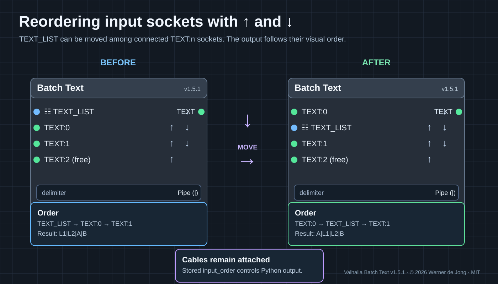

# Valhalla Batch Text v1.6.3

**ComfyUI custom node · © 2026 Werner de Jong · MIT License**

Valhalla Batch Text combines connected text values and optional native ComfyUI STRING lists into one text output. It preserves the chosen input order, supports configurable delimiters, optional text preview and optional logging.

**Latest stable release:** [v1.6.3](https://github.com/darkvalley/Valhalla/releases/tag/v1.6.3) · [Download installable ZIP](https://github.com/darkvalley/Valhalla/releases/download/v1.6.3/Valhalla_BatchText_v1.6.3.zip).

## New in v1.6.3

- **Daily workflow logs:** one `<workflow_name>_YYYYMMDD.txt` file per workflow, with a separated, dated entry for each run.
- **Durable log folder:** the selected path survives workflow save/reload and frontend upgrades.
- **Logging independent of preview:** you can enable `write_log` while `show_preview` is off.
- **Automatic input names:** a connected `scene_text` output appears as `scene_text` on the Batch Text input, while its technical ID stays `TEXT:n`.
- **Persistent manual labels:** **Rename Slot** names survive new connections, input reordering and reopening the workflow.

## Wiki navigation

- [Batch Text overview](Batch-Text)
- [Automatic and Manual Input Labels](Automatic-and-Manual-Input-Labels)
- [Preview and Logging](Preview-and-Logging)
- [Reordering Inputs](Reordering-Inputs)
- [Using TEXT_LIST](Using-TEXT-LIST)
- [Combining Inputs and Delimiters](Combining-Inputs-and-Delimiters)
- [Installation and Troubleshooting](Installation-and-Troubleshooting)

**Source code:** [ComfyUI/Valhalla_BatchText](https://github.com/darkvalley/Valhalla/tree/main/ComfyUI/Valhalla_BatchText).

The separate ValhallaTextStudio is not part of this release.
