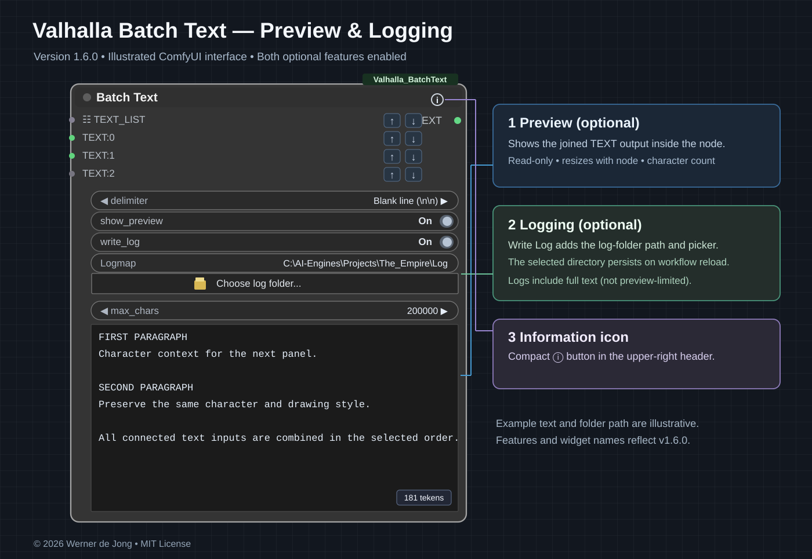

# Valhalla Batch Text v1.6.0 — Wiki

**New in v1.6.0:** Optional read-only, resizable combined-text preview (off by default), character counter, max_chars, cumulative full-text logging (off by default), persistent single log-folder chooser, and a compact header Info icon. [Preview and Logging](https://github.com/darkvalley/Valhalla/wiki/Preview-and-Logging).

**ComfyUI • Conceived and created by Werner de Jong • © 2026 • MIT License**

Batch Text joins any number of `STRING` inputs and an optional native `STRING` list into a **single text output**, using a selectable delimiter.

**v1.5.4:** change the processing order using the **up/down arrows** next to input sockets. The selected order and its original cables remain intact after saving and reopening a workflow, including after a ComfyUI restart.

*The illustrated v1.6.0 interface with **show_preview** and **write_log** enabled. Example text and folder path are illustrative.*

[Earlier input-order diagram](https://raw.githubusercontent.com/darkvalley/Valhalla/main/ComfyUI/Valhalla_BatchText/docs/images/01-node-overview.svg) · [Preview and Logging details](https://github.com/darkvalley/Valhalla/wiki/Preview-and-Logging)

## Documentation

- [Batch Text — Overview](https://github.com/darkvalley/Valhalla/wiki/Batch-Text)
- [Reordering Inputs](https://github.com/darkvalley/Valhalla/wiki/Reordering-Inputs) — **persistence fixed in v1.5.4**
- [Using TEXT_LIST](https://github.com/darkvalley/Valhalla/wiki/Using-TEXT-LIST)
- [Combining Inputs and Delimiters](https://github.com/darkvalley/Valhalla/wiki/Combining-Inputs-and-Delimiters)
- [Installation and Troubleshooting](https://github.com/darkvalley/Valhalla/wiki/Installation-and-Troubleshooting)

**Official GitHub Release:** [v1.6.0](https://github.com/darkvalley/Valhalla/releases/tag/v1.6.0) · [Download installation ZIP](https://github.com/darkvalley/Valhalla/releases/download/v1.6.0/Valhalla_BatchText_v1.6.0.zip).

**Source code:** [Valhalla Batch Text](https://github.com/darkvalley/Valhalla/tree/main/ComfyUI/Valhalla_BatchText) · [MIT license](https://github.com/darkvalley/Valhalla/blob/main/ComfyUI/Valhalla_BatchText/LICENSE).

*The diagrams illustrate the actual socket names and ordering rules; they are documentation diagrams, not live screenshots.*
