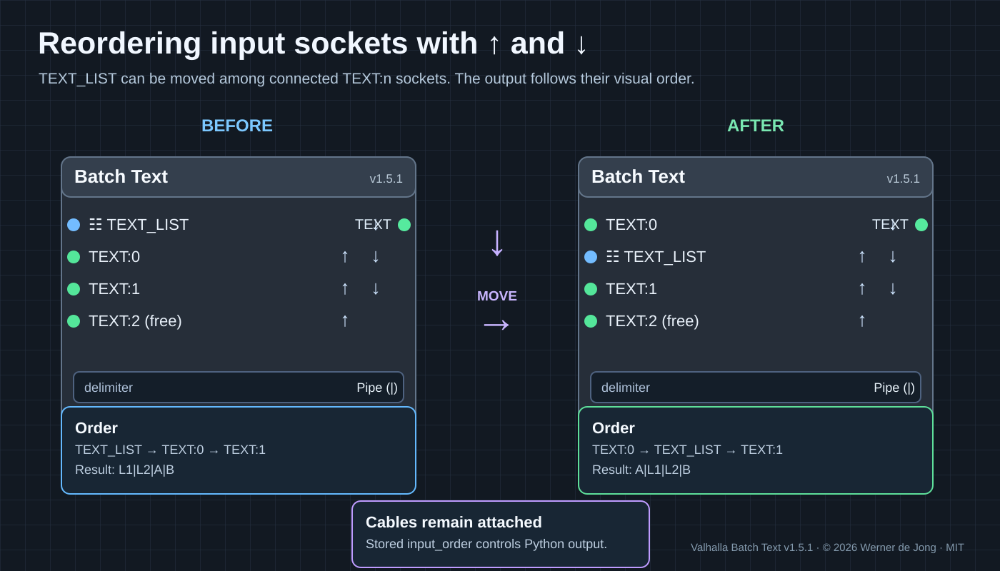

# Reordering Inputs — v1.6.3

The **up/down arrows** beside input sockets set the actual order in which Batch Text joins the values. They move the linked cable with the socket; they do not merely rearrange the labels on screen.

## Example

Suppose `TEXT_LIST` contains `L1` and `L2`, `TEXT:0` receives `A`, `TEXT:1` receives `B` and the delimiter is `Pipe (|)`.

| Input order | Combined text |
| --- | --- |
| `TEXT_LIST`, `TEXT:0`, `TEXT:1` | `L1|L2|A|B` |
| `TEXT:0`, `TEXT_LIST`, `TEXT:1` | `A|L1|L2|B` |
| `TEXT:0`, `TEXT:1`, `TEXT_LIST` | `A|B|L1|L2` |

The optional list expands its items at the position of the `TEXT_LIST` socket.

## Saving and reloading

Batch Text stores its chosen order in `input_order` and the workflow property `valhalla_batch_text_socket_order`. When you reopen the workflow, the order and linked sources are restored, including in modern ComfyUI versions with a separate link store.

### Visible labels and true IDs

Since v1.6.3 a socket may display its source output name, for example `scene_text`, or a manual name set through **Rename Slot**. The underlying name remains `TEXT:n` and the label follows that input when it moves. Manual labels are saved independently in workflow metadata.

**Do not change `input_order` or the technical `TEXT:n` IDs by hand.** Use the up/down arrows to reorder and **Rename Slot** to change only the display label.

[Automatic and Manual Input Labels](Automatic-and-Manual-Input-Labels) · [Batch Text](Batch-Text).
